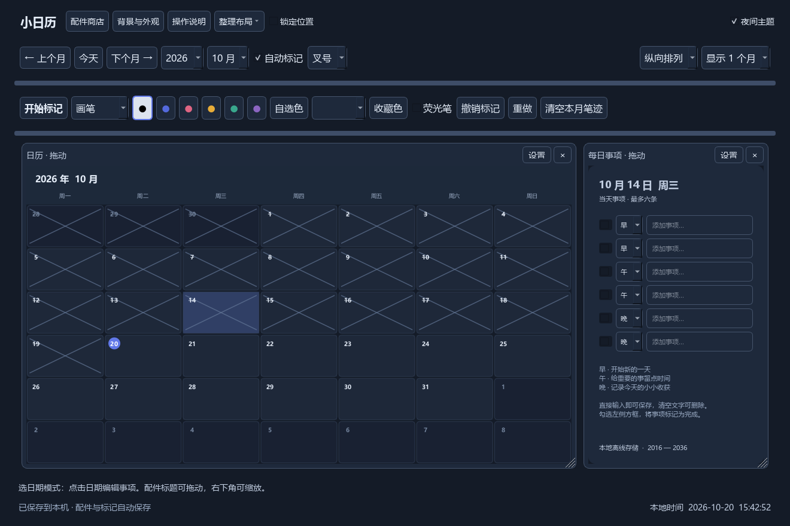

# 小日历 · v0.5.0 自由桌面与插件库

本地构建文件位于 `dist` 文件夹；GitHub 发布见 [Releases](https://github.com/BlinB209/little-calendar/releases)。

Windows：双击 `小日历-v0.5.0.exe` 即可运行，不需要安装 Python。本地构建输出为 `dist/小日历-v0.5.0.exe`。

## 新版操作

- **配件商店**：查看用途和使用方法，点击“添加到桌面”。便签、待办、独立月历、时钟和习惯打卡可重复添加。
- **第三方插件库**：在商店的“第三方插件”页导入自己或他人的 ZIP 插件包、或源码目录中的 `manifest.json`，确认信任后启用，再添加到桌面。支持停用、打开源码目录、自编辑后重新加载，以及导出可编辑示例。
- **模块颜色与透明度**：点击模块标题“设置 → 颜色与透明度”，或“我的桌面 → 外观”，独立选择底色、文字色及 15–100% 整体不透明度。100% 为完全不透明，数值越低越透明；支持实时预览、取消还原和恢复主题。
- **自由摆放**：按住配件标题拖动到任意位置，拖右下角斜线缩放；配件可以重叠，点击标题置于最前。位置和尺寸自动保存。
- **整理与找回**：顶部“整理布局”可分栏、平铺或层叠。商店的“我的桌面”可以显示、隐藏、重命名和定位配件。× 只隐藏，内容保留。
- **锁定位置**：禁止拖动和缩放，仍可编辑配件内容。
- **本地图片**：打开“背景与外观”，选择图片、检查预览并保存。选图后自动启用图片背景；降低日期格底色不透明度，可以更清楚地看到背景。
- **绘画与印章**：点击“开始标记”，选择画笔、橡皮擦或日期印章。“返回选日期”后可继续编辑事项。橡皮擦删除经过的整笔笔迹及日期上的印章，可撤销；形状、文字、粗细和透明度在“背景与外观 → 标记与图层”设置。
- **颜色与自动标记**：支持任意颜色、收藏色和图层显隐；自动标记条件可选已过日期、周末或当日事项全部完成。
- **操作说明**：顶部按钮提供常用操作指引，当前工具的操作方法显示在窗口下方。

本地商店不依赖服务器，提供五种内置配件；导入 JSON 可创建使用现有配件类型的模板。Python 插件可创建新的界面与逻辑，多个实例分别保存数据。导入只存储文件；首次运行或源码改变后需要确认，停用保留内容。开发接口、存储路径、依赖范围与示例见 [PLUGINS.md](PLUGINS.md)。

Python 插件在日历进程内运行，具有本机用户权限，并非沙箱，请只启用可信源码。若插件导致启动异常，可用 `小日历-v0.5.0.exe --safe-mode` 禁止第三方代码运行，再去插件库停用。源码使用 `python app.py --safe-mode`，Ubuntu 使用 `little-calendar --safe-mode`。

## 日历功能

- 读取本地时间，支持当前年份前后各十年，跨年自动更新范围，月视图补齐相邻月份日期。
- 可同时显示 1 至 3 个月，并切换横向或纵向排列；窗口可调整大小。
- 点击日期，在右侧编辑最多六条事项，自由选择早、午、晚；文字自动保存。
- 拖动窗口边缘调整整体大小；拖动浅蓝色分隔条调整导航栏和画笔栏，多个月份之间也可拖动调整。
- 字体随区域大小自动缩放，较小窗口可滚动查看；关闭后记住窗口和各区域尺寸。
- 可选“自动划去已过日期”，默认关闭。开启后按本地日期划去今天之前的日期，跨午夜自动刷新；关闭即可恢复显示，设置自动保存，不改动事项或笔迹。
- 划去样式可选斜线、叉号、横线、淡化；开启自动划去后使用旁边的下拉框选择。
- 右上角“夜间主题”可切换深色界面，主题和划去样式会自动记住；黑笔在夜间增加浅色描边以便识别。
- 开启画笔后，在日历上拖动画线。支持黑色及另外五种颜色、荧光笔、撤销、重做，选中的颜色有边框提示。
- 笔迹跟随月份保存，调整窗口后按比例缩放。撤销针对最后点击或绘画的月份。
- 快捷键：Ctrl+Z 撤销笔迹、Ctrl+Y 重做、T 跳到今天。事项输入框内保留文本编辑的撤销/重做，输入 T 不会跳转日期。
- 事项启动时载入内存，重绘不查询 SQLite；编辑时自动写入本地数据库。
- 数据保存在 `%LOCALAPPDATA%/LittleCalendar/calendar.sqlite3`，背景副本在同目录的 `backgrounds/` 中。关闭应用后备份整个目录。跨电脑迁移后需重新选择背景图片，因为当前设置记录本机图片路径。

尚未提供整套配置、事项与笔迹的导入导出。

Ubuntu：运行 `sudo apt install ./little-calendar_0.5.0_all.deb`，详细安装与验证状态见 [UBUNTU.md](UBUNTU.md)。

## 源码运行

Windows：Python 3.10 或以上，安装 requirements.txt 后执行 `python app.py`。

Ubuntu：使用系统包 `python3-pyqt6` 和 `fonts-noto-cjk`，执行 `python3 app.py`。

Windows 打包：安装依赖到 `.venv` 后执行 `powershell -ExecutionPolicy Bypass -File build_windows.ps1`。

Ubuntu 打包：`python build_ubuntu.py`。此包不含本机二进制，依赖由 apt 安装；实际 Ubuntu 桌面运行尚待验证。

Windows 功能检查：`verify.py`、`verify_preview.py`、`verify_layout.py`、`verify_background.py`、`verify_shop.py` 使用临时数据库及 PySide6。插件检查见 `verify_python_plugins.py`、`verify_plugin_library_ui.py`；外观检查见 `verify_module_appearance.py`、`verify_appearance_integration.py`。打包后的 `--smoke-test` 还检查图片解码、商店、外观设置，以及示例插件的导出、导入、动态加载、数据隔离和停用恢复，不改动个人数据。
